

  

<samp>

&gt; i don't remember logging on.

somewhere behind a windows machine, making small local-first things. 
no telemetry, no analytics, no backend of mine. when something does reach the 
network it is github asking about updates, or a service you picked yourself. 
the wired isn't somewhere else. it's this room, with the lights off.

</samp>

  

### <samp>// devices on this node</samp>

  <a href="https://github.com/slashneck/Lockwell"></a>
  <a href="https://github.com/slashneck/Onyx"></a>
  <a href="https://github.com/slashneck/Precut-Pro"></a>
  <a href="https://github.com/slashneck/Snappy"></a>
  <a href="https://github.com/slashneck/Cargo"></a>
  <a href="https://github.com/slashneck/BetterComfy"></a>
  <a href="https://github.com/slashneck/Lemonade"></a>
  <a href="https://github.com/slashneck/Riffle"></a>

<samp><b>layer:00 // protocol</b></samp>

 
<samp>

things i believe about software, in no particular order:

- it should still run when the internet doesn't.
- it should not need to know my name.
- the file is the truth. the app is only a window onto it.
- if it needs an account to open something i already have, it isn't mine.
- delete should mean delete.

everything above this line is built for one machine. mine. maybe yours.

</samp>

  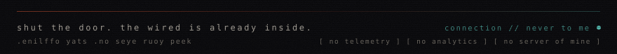

<!--
  the art is hand-written svg. nothing here calls a third-party badge service,
  so no one gets a log line when someone looks at this page.
  regenerate after changing a repo:  python tools/gen.py --fetch
  let's all love lain.
-->
